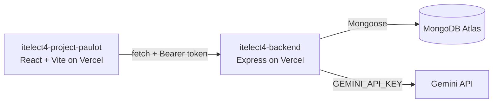

# CloudOps Portal — Frontend Application (ITELECT4 GT4)

[](https://github.com/papap7/itelect4-project-paulot/actions/workflows/ci.yml)

Modern single-page application (SPA) for the CloudOps Infrastructure Provisioning and Workspace Management Portal.

## 🔗 Live Deployments & Repositories

- **Live Frontend App:** [https://itelect4-project-paulot.vercel.app](https://itelect4-project-paulot.vercel.app)
- **Live Backend API:** [https://itelect4-backend-sand.vercel.app](https://itelect4-backend-sand.vercel.app)
- **Frontend GitHub Repo:** [https://github.com/papap7/itelect4-project-paulot](https://github.com/papap7/itelect4-project-paulot)
- **Backend GitHub Repo:** [https://github.com/papap7/itelect4-backend](https://github.com/papap7/itelect4-backend)

---

## 🏗️ Architecture



---

## 🛠️ Tech Stack

- **Framework:** React 19 + TypeScript + Vite
- **Styling:** Tailwind CSS + shadcn/ui components
- **Routing:** React Router v7
- **Server State & Caching:** TanStack React Query v5
- **Client State:** Zustand with persistent storage
- **Form Validation:** React Hook Form + Zod
- **Testing:** Vitest + Testing Library (jsdom)
- **CI:** GitHub Actions (lint, test and build on every push)
- **Deployment:** Vercel

---

## ✨ Features

- **Dashboard:** Real-time infrastructure metrics (workspaces, engineers, pending requests count), workspace search filter, and engineering team roster.
- **Reference Workspaces:** Fetches and displays all available workspaces live from the backend API.
- **User Authentication:** Registration and login authenticated via JWT with state persisted in client storage.
- **AI Advisor:** Logged-in engineers describe the resources they need and get a structured review (summary, suggestions, risks, urgency) from Gemini, through the backend's `POST /api/ai`.
- **Provision Requests:** Protected workflow allowing engineers to request infrastructure provisioning with cloud provider validation (AWS, GCP, Azure).

---

## 💻 Local Development

1. **Clone repository:**
   ```bash
   git clone https://github.com/papap7/itelect4-project-paulot.git
   cd itelect4-project-paulot
   ```
2. **Install dependencies:**
   ```bash
   npm install
   ```
3. **Configure Environment:**
   Create `.env` using `.env.example`:
   ```env
   VITE_API_URL=https://itelect4-backend-sand.vercel.app
   ```
4. **Run Dev Server:**
   ```bash
   npm run dev
   ```
5. **Build for Production:**
   ```bash
   npm run build
   ```
6. **Run the tests:**
   ```bash
   npm test
   ```
   The tests need no `.env`, no backend and no internet: they use a fixed `VITE_API_URL` from `vite.config.ts` and never send a request. `npm run test:watch` re-runs them as you save.

---

## 🧪 Tests & CI

Three Vitest tests, each beside the file it tests:

- `src/components/RequestBadge.test.tsx` — the status text the badge shows for a request.
- `src/hooks/useToggle.test.ts` — the hook's starting value and each toggle.
- `src/pages/LoginPage.test.tsx` — the login form shows the schema's messages and sends no request while it is invalid.

`.github/workflows/ci.yml` runs `npm run lint`, `npm test` and `npm run build` on every push. The badge at the top of this file shows the result of the latest run.

---

## 🤖 AI Use Disclosure

<!-- TODO (author): list the AI tools you used, what for, and what you wrote or changed yourself. -->
_To be completed by the author._
